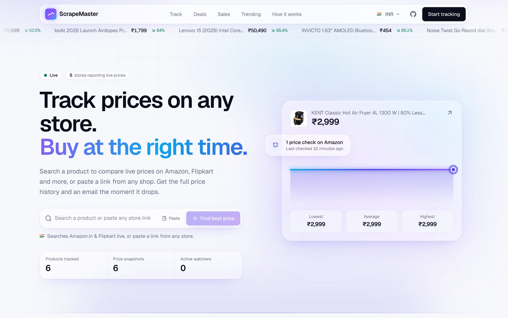
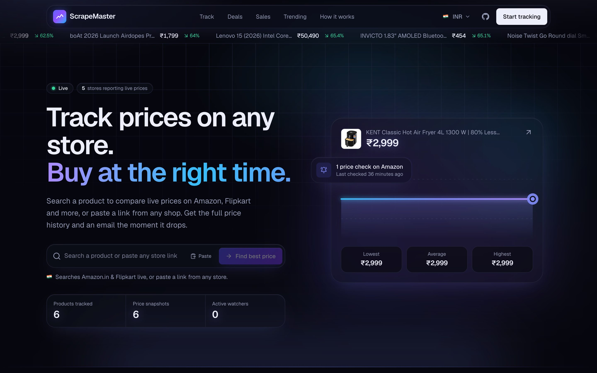
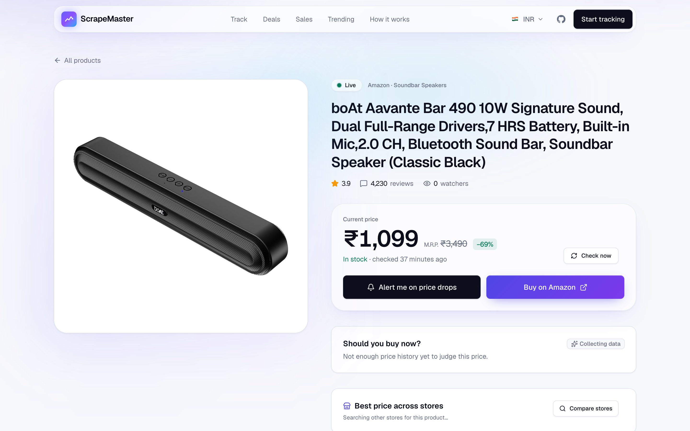
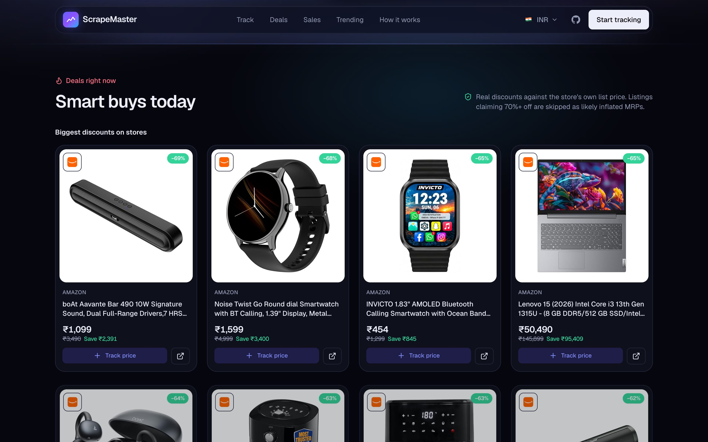
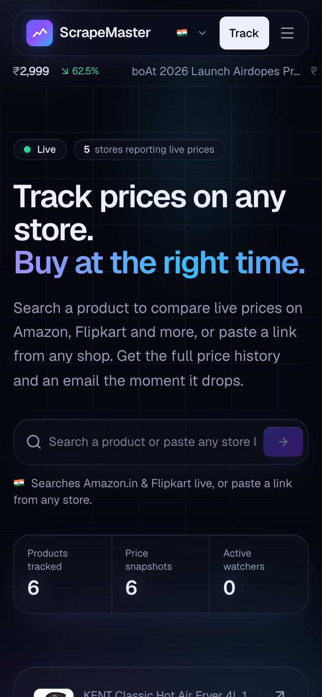
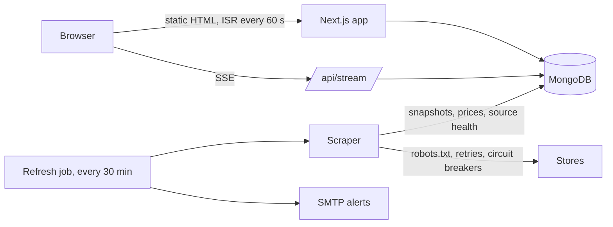

<div align="center">

# ScrapeMaster

**Live prices, full price history and drop alerts for Amazon, Flipkart and any online store.**

[**Open the live site →**](https://scrape-master-ai.vercel.app)

[](https://github.com/sAchin-680/ScrapeMaster/actions/workflows/ci.yml)
[](https://github.com/sAchin-680/ScrapeMaster/actions/workflows/codeql.yml)
[](https://github.com/sAchin-680/ScrapeMaster/actions/workflows/refresh.yml)


<br />



</div>

<table>
  <tr>
    <td width="50%"></td>
    <td width="50%"></td>
  </tr>
  <tr>
    <td align="center"><sub>Dark mode, a first-class theme</sub></td>
    <td align="center"><sub>Product page: live price, reference price and alerts</sub></td>
  </tr>
  <tr>
    <td width="50%"></td>
    <td width="50%" align="center"></td>
  </tr>
  <tr>
    <td align="center"><sub>Live deals, with inflated MRPs filtered out</sub></td>
    <td align="center"><sub>Built for phones first</sub></td>
  </tr>
</table>

## Contents

- [Why ScrapeMaster](#why-scrapemaster)
- [Features](#features)
- [Quick start](#quick-start)
- [How it works](#how-it-works)
- [Performance and accessibility](#performance-and-accessibility)
- [Project structure](#project-structure)
- [Configuration](#configuration)
- [API](#api)
- [Deployment](#deployment)
- [Contributing](#contributing)
- [Legal](#legal)

## Why ScrapeMaster

A price chart alone does not tell you whether to buy. ScrapeMaster pairs every product's own history with a plain verdict, checks the same product across stores, and only counts a discount as real when it holds up against the store's own list price. It reads every store live, with no demo or seeded data.

## Features

|                                |                                                                                                                                       |
| ------------------------------ | ------------------------------------------------------------------------------------------------------------------------------------- |
| 🔎 **Live multi-store search** | Searches every store for your country in parallel, groups identical listings, and shows the cheapest one first.                       |
| 🔗 **Any store**               | Dedicated adapters for Amazon and Flipkart. Any other shop works through its schema.org or OpenGraph product data. Paste any link.    |
| 📈 **Price history**           | An interactive chart of every recorded price, with lowest, average and highest marked.                                                |
| 🧭 **Buy-or-wait verdict**     | A "should you buy now?" score based on the product's own history, not the store's claims.                                             |
| 🔔 **Alerts**                  | Emails on new lows, big discounts or restocks, each with one-click unsubscribe.                                                       |
| 🏷️ **Honest deals**            | Live store discounts measured against each store's own list price. Listings claiming 70% or more off are skipped as likely inflated.  |
| 📡 **Sale radar**              | Reads live sale banners from store homepages, plus a calendar of upcoming sales.                                                      |
| ⚡ **Real time**               | Prices stream to open pages over Server-Sent Events. Stale products re-check in the background when someone views them.               |
| 🌍 **Localized**               | Pick a country and currency; prices convert with daily exchange rates. Defaults to India and INR.                                     |
| 🩺 **Visible reliability**     | Each store's success rate and last good refresh appear on the home page and at [`/status`](app/status/page.tsx).                      |
| 🤝 **Responsible collection**  | Follows robots.txt, identifies itself honestly, rate-limits per site and prefers official data feeds. See [`/bot`](app/bot/page.tsx). |

## Quick start

Requires Node.js 22+ and MongoDB. Chrome or Chromium is needed for the refresh job (Flipkart product pages and store homepages).

```bash
git clone https://github.com/sAchin-680/ScrapeMaster.git
cd ScrapeMaster
npm install
cp .env.example .env.local   # set MONGODB_URI at minimum
npm run db                   # optional: local MongoDB in ./.data
npm run dev                  # http://localhost:3000
```

Then try it:

1. **Track a product.** Paste an Amazon or Flipkart product link into the search bar, or search by name.
2. **Fill the store feeds.** Run `npm run feeds:refresh` to load deals, trending products, sale banners and store health.
3. **Get alerts.** Set the SMTP variables, open a product and choose _Alert me on price drops_.

Prefer containers? `docker compose up -d --build` starts the app, MongoDB and a refresh scheduler. See [Deployment](#deployment).

## How it works



Visitors never wait on a store. The home page is static and regenerated in the background at most once a minute, and store feeds are read from snapshots the refresh job writes. The job runs on GitHub Actions because stores block requests from hosting providers' IP ranges. Headless Chromium runs only in that job, never on a visitor's request.

| Layer     | Implementation                                                                                                                                              |
| --------- | ----------------------------------------------------------------------------------------------------------------------------------------------------------- |
| App       | Next.js 16 App Router (Turbopack), React 19, Server Components and Server Actions                                                                           |
| Data      | MongoDB with Mongoose 9, capped embedded price history, and indexes for listing and streaming                                                               |
| Scraping  | Store adapters (`lib/scraper/stores`), structured data extraction, SSRF guard, per-host throttling, and a headless browser for stores that block plain HTTP |
| Matching  | Token containment with spec-conflict penalties, accessory filtering and price sanity checks (`lib/scraper/match.ts`)                                        |
| Delivery  | Static home page with ISR, preferences applied in the browser, and a database pool reused across serverless invocations (`attachDatabasePool`)              |
| Real time | SSE stream on an `updatedAt` cursor, resumable via `Last-Event-ID`, which works on any MongoDB deployment                                                   |
| UI        | Tailwind CSS 4 design tokens with light and dark themes, Headless UI, hand-built SVG charts                                                                 |
| Checks    | Zod 4 validation at every boundary, Vitest 5, ESLint 10 with the React Compiler rules                                                                       |

### Reliability

Every store request goes through `loadAndParse` (`lib/scraper/load.ts`):

- **Retries** with exponential backoff and full jitter, only for transient errors (timeouts, rate limits, bot checks). A missing page or a robots.txt disallow is not retried.
- **Circuit breaker** per source, meaning a store plus a page type such as `amazon:product`. After three consecutive failures the source is paused for two hours, with ±10% jitter. A single trial request then decides whether it resumes.
- **Health records**: the last 50 outcomes per source are persisted between runs. They drive the status panel and the per-store summary the job prints, which also appears on the Actions run page.
- **Run outcome**: the job fails only when most stores failed or were paused. One blocked store keeps its last snapshot and is reported, rather than turning the job red.

### Responsible data collection

- **robots.txt** is fetched and followed for every host (`lib/scraper/robots.ts`, RFC 9309, cached for a day). Pages it disallows are never requested. For example, Flipkart's search pages are excluded, so Flipkart search uses the official Affiliate API when credentials are set.
- **Honest user agent**: requests carry `ScrapeMasterBot/1.0` and a link to [`/bot`](app/bot/page.tsx), which explains what is collected and how to opt out.
- **Rate limits**: at least 1.2 s between requests to the same host, a fixed number of products per run, and no proxies.

## Performance and accessibility

Measured on a production build with a throttled mid-range phone profile (4× CPU slowdown, slow 4G), median of three runs:

| Page    | Largest Contentful Paint | Total Blocking Time | Layout shift |
| ------- | ------------------------ | ------------------- | ------------ |
| Home    | 1.8 s                    | 30 ms               | 0.010        |
| Product | 1.6 s                    | 7 ms                | 0.001        |
| Search  | 0.9 s                    | 17 ms               | 0.000        |

All are inside Google's "good" thresholds (LCP ≤ 2.5 s, CLS ≤ 0.1). What keeps them there:

- The main content paints without waiting for JavaScript: hero copy and above-the-fold product images are never hidden behind a fade-in.
- Fonts are self-hosted as Latin-subset woff2, and only the main face is preloaded.
- Cards skip backdrop blur, so long product grids scroll smoothly; frosted glass is reserved for floating chrome.
- Scroll reveals use CSS scroll-driven animations, off the main thread, and every animation respects `prefers-reduced-motion`.

The palette's text colors meet WCAG AA contrast (4.5:1) in both themes, including price-change colors on their tinted backgrounds. The home, product and search pages use one `h1`, ordered headings and labelled controls, and every interactive element has a visible focus ring.

## Project structure

```text
app/                 Routes: home, search, products/[id], track, status, bot, legal pages
  api/               stream (SSE), cron, health, suggest, unsubscribe, admin/sales
  globals.css        Design tokens and utilities: glass, aurora, glow, lift, card
components/          UI: hero, product cards, charts, search, live price widgets
  live/              Client components fed by the SSE stream
  ui/                Primitives: product tile, image, money, logo, sparkline
lib/
  scraper/           Fetching, robots.txt, retries, circuit breakers, store adapters
  services/          Tracking, refresh, offers, store feeds, snapshots, source health
  data/              Server-side reads for pages
  models/            Mongoose schemas
scripts/             refresh-feeds.mts, the scheduled refresh job
tests/               Vitest unit tests (154)
```

## Configuration

| Variable                                                         | Purpose                                                 |
| ---------------------------------------------------------------- | ------------------------------------------------------- |
| `MONGODB_URI`                                                    | Database connection (required)                          |
| `NEXT_PUBLIC_SITE_URL`                                           | Public URL for metadata and email links                 |
| `APP_SECRET`                                                     | Signs unsubscribe links (required in production)        |
| `CRON_SECRET`                                                    | Bearer token for `/api/cron`                            |
| `ADMIN_TOKEN`                                                    | Bearer token for `/api/admin/sales`                     |
| `CHROME_EXECUTABLE_PATH`                                         | Local Chrome/Chromium for browser-rendered stores       |
| `BROWSER_WS_ENDPOINT`                                            | Remote browser (`ws://` or `wss://`) for serverless     |
| `BROWSER_ON_REQUEST`                                             | Allow the web server itself to start a browser (Docker) |
| `SMTP_HOST` `SMTP_PORT` `SMTP_USER` `SMTP_PASSWORD` `EMAIL_FROM` | Alert email delivery                                    |
| `FLIPKART_AFFILIATE_ID` `FLIPKART_AFFILIATE_TOKEN`               | Flipkart search through its official Affiliate API      |

## API

| Endpoint                               | Auth                 | Description                          |
| -------------------------------------- | -------------------- | ------------------------------------ |
| `GET /api/stream?ids=`                 | Public               | SSE feed of product changes          |
| `GET /api/cron`                        | `Bearer CRON_SECRET` | Refresh all products and send alerts |
| `GET /api/health`                      | Public               | Database health check                |
| `GET · POST · DELETE /api/admin/sales` | `Bearer ADMIN_TOKEN` | Manage sale events                   |
| `POST /api/unsubscribe`                | Signed link          | One-click unsubscribe (RFC 8058)     |

## Deployment

**Vercel.** Import the repo and set the variables above. The `Refresh store data` workflow (`.github/workflows/refresh.yml`) refreshes everything every 30 minutes; give it the `MONGODB_URI` secret, plus the SMTP secrets for alerts. `vercel.json` also schedules a daily `/api/cron` as a fallback. The `Deploy` workflow can deploy after CI once `VERCEL_TOKEN`, `VERCEL_ORG_ID` and `VERCEL_PROJECT_ID` are set as repository secrets.

**Docker.** `docker compose up -d --build` runs the app (with Chromium, enabled via `BROWSER_ON_REQUEST`), MongoDB and a refresh scheduler. Multi-architecture images (amd64 and arm64, each built on a native runner) are published to GHCR on every push to `main` and on version tags:

```bash
docker pull ghcr.io/sachin-680/scrapemaster:latest
```

## Contributing

Issues and pull requests are welcome. Before opening a pull request, run the same checks CI does:

```bash
npm run format:check && npm run lint && npm run typecheck && npm run test:coverage && npm run build
```

CI also builds the Docker image and smoke-tests the container. CodeQL and Dependabot run on schedule.

Available scripts: `dev` · `build` · `start` · `lint` · `typecheck` · `test` · `test:coverage` · `format` · `format:check` · `db` · `feeds:refresh`

## Legal

ScrapeMaster is not affiliated with any retailer. Store names and logos belong to their owners. Retailer terms may restrict automated access even where robots.txt allows it, so review them before operating a public deployment, and prefer official feeds where they exist. See [Privacy](app/privacy/page.tsx) and [Terms](app/terms/page.tsx).
